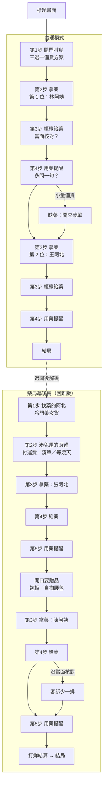

# 到你手上之前｜社區藥局生存戰

> 站進藥局櫃檯後面，看看一袋藥交到你手上之前，藥師都在忙什麼。

一款給**藥局候藥患者**玩的 3 分鐘衛教小遊戲。玩家扮演社區藥師，在倒數計時內照處方拿藥、決定要不要當面核對、要不要多問一句用藥習慣，並從結局中學到領藥時可以怎麼保護自己。

| 標題畫面 | 數藥、剪藥排 | 用藥提醒 |
|:---:|:---:|:---:|
|  |  |  |

---

## 目錄

1. [設計目標](#1-設計目標)
2. [目標族群與使用情境](#2-目標族群與使用情境)
3. [衛教訊息](#3-衛教訊息)
4. [遊戲流程](#4-遊戲流程)
5. [核心機制與數值](#5-核心機制與數值)
6. [結局設計](#6-結局設計)
7. [內容與文案準則](#7-內容與文案準則)
8. [技術架構](#8-技術架構)
9. [開發與部署](#9-開發與部署)
10. [修改內容指南](#10-修改內容指南)
11. [免責聲明](#11-免責聲明)

---

## 1. 設計目標

| 目標 | 做法 |
|---|---|
| 讓患者理解「為什麼領藥要等」 | 親手體驗劑量相近的藥盒、每排 10／14／15 顆不同的包裝、剪藥排 |
| 讓患者願意「當面一起核對」 | 跳過當面核對可能導致拿錯藥（結局 C）或「少一排」的爭執 |
| 讓患者主動說出保健食品、中藥 | 多問一句才能發現鈣片影響甲狀腺藥吸收；跳過就進入結局 B |
| 傳達藥師的責任感 | 結局 C：藥師自己發現錯誤、主動打電話、送藥、陪病人聯絡醫師 |
| 符合候藥時間 | 普通模式約 3 分鐘，被叫號時可隨時暫停 |

**不做的事：** 不提供個人用藥建議；藥名全部虛構；不收集任何個人資料。

## 2. 目標族群與使用情境

| | 普通模式（主推） | 藥局幕後篇（困難版） |
|---|---|---|
| 對象 | 候藥患者與家屬，含長輩 | 藥學系學生、社區衛教活動、對藥局經營有興趣的人 |
| 主題 | 用藥安全 | 小藥局經營：冷門藥、免運門檻、房租、贈品法規 |
| 長度 | 約 3 分鐘、2 位客人 | 稍長，事件較多、2 位客人 |
| 解鎖 | 一開始就能玩 | 普通模式過關後解鎖 |

**使用方式：**
- **患者自己的手機：** 在候藥區張貼 QR Code 連到上方網址。圖片總共約 360 KB，用行動網路也能很快開啟。
- **藥局共用平板：** 直接開網址即可。2 分鐘沒有操作、且沒有倒數進行時，會自動回到標題畫面，下一位患者不會看到上一位玩到一半或結局畫面。

**為候藥情境做的設計：**
- 切換 App 或鎖定螢幕時自動暫停，暫停畫面寫著「叫到號碼領藥……不會扣時間」。
- 字級比一般網頁放大一級，最小 14px。
- 全程無音效。

## 3. 衛教訊息

遊戲希望患者帶走三句話：

1. **領藥時跟藥師一起核對藥名和劑量。**
2. **主動告訴藥師平常吃的保健食品、中藥和其他西藥。**
3. **回家發現藥的顏色、形狀跟平常不一樣，先別吃，打電話問藥局。**

醫學內容依據：

| 情境 | 內容 |
|---|---|
| 鈣片與甲狀腺素（護甲寧） | 高劑量鈣片會降低左旋甲狀腺素吸收，建議間隔至少 4 小時服用 |
| 劑量相近的藥品 | 同品名不同劑量（80／160 mg、50／100 mcg、5／10 mg）外盒相似，是常見的給藥錯誤來源 |
| 併用風險（結局 B 小知識） | 鈣片、鐵劑、制酸胃藥可能影響甲狀腺藥、骨鬆藥、部分抗生素吸收；丹參、當歸等活血中藥或銀杏與抗凝血藥併用可能增加出血風險 |
| 贈品招徠（困難版） | 健保規定特約藥局不得以不當方式招徠病人；藥師本人違反時，依《藥師法》可能移付懲戒 |

## 4. 遊戲流程



任何一步都可能提早進入結局：拿錯藥（C）、超時或好感歸零（D）、現金歸零（E）、第 1 位客人沒做用藥提醒（B）。

## 5. 核心機制與數值

### 三項狀態

| 狀態 | 開局 | 意義 |
|---|---|---|
| 現金 | 300 | 歸零即結局 E；結算時 ≤ 120 為結局 1B |
| 架上藥 | 300 | 進貨增加、每發一張處方 −10 |
| 好感 | 50 | 歸零即結局 D |

直接從標題畫面開始困難版時，以 現金 210／架上藥 400／好感 70 開局；從普通模式過關接續時，沿用過關時的數值。

### 拿藥（倒數計時）

- 倒數時間：普通模式 **65 秒**、困難版 **45 秒**，涵蓋「拿藥 → 給藥」兩步。
- 點藥盒開啟藥排抽屜，用「±1 排」「剪 ±1 顆」湊出處方顆數；遊戲**不會提示對錯**。
- 當面核對會花掉倒數時間：沒問題 2.6 秒、發現拿錯並重拿 5.6 秒。

### 普通模式備貨方案

| 方案 | 花費 | 每張處方收入 | 影響 |
|---|---|---|---|
| A 小量備貨 | 80 | 12 | 第 2 位客人的好壓降 160 mg 缺貨，開欠藥單（好感 −5） |
| B 適量備貨 | 120 | 15 | 最平衡 |
| C 多量備貨 | 240 | 25 | 現金只剩 60，過關也會是結局 1B |

### 困難版事件

| 事件 | 選項與影響 |
|---|---|
| 湊免運 | 付運費：現金 −90／湊滿 150 免運：現金 −150；結算時現金 ≤ 80 即結局 E／等幾天：現金 −30、好感 −15 |
| 要贈品 | 婉拒：好感 −10／自掏腰包送貼布：現金 −20、好感 +10 |
| 沒當面核對 | 第 2 位客人回來說少一排：現金 −45、好感 −35 |
| 打烊 | 房租電費：現金 −15 |

## 6. 結局設計

| 結局 | 條件 | 普通模式標題 | 想傳達的事 |
|---|---|---|---|
| **A** 圓滿過關 | 全部拿對、做了第 1 位的用藥提醒、現金充足 | 讓人安心的社區好藥師 | 當面點清和多問兩句的價值 |
| **1B** 過關但現金吃緊 | 過關但現金 ≤ 120 | 看起來賺得多，手頭現金卻很緊 | 小藥局的現金周轉壓力 |
| **B** 沒問出吃藥衝突 | 第 1 位客人選「簡單交代」 | 藥都拿對了，藥效卻打了折 | 主動告訴藥師保健食品、中藥 |
| **C** 拿錯藥了 | 給藥時藥名、劑量或顆數不符 | 一顆藥的重量 | 藥師的責任感；患者回家發現藥不一樣先別吃 |
| **D** 失去信任 | 倒數歸零或好感歸零 | 等得不耐煩，客人走了 | 速度與細心的平衡 |
| **E** 現金見底 | 現金歸零 | 藥堆滿架上，口袋沒現金 | 囤貨與冷門藥的經營風險 |

每個結局都附一則**用藥小知識**，並收錄在「結局圖鑑」（存在瀏覽器 localStorage，可重置）。

**結局 C 的兩種寫法：**
- **普通模式：** 藥師打烊前自己發現錯誤、主動聯絡、送藥並陪病人聯絡醫師，重點是藥師負起責任，避免讓候藥患者對藥局產生不安。
- **困難版：** 保留醫療訴訟與停業的嚴重後果。

## 7. 內容與文案準則

修改劇本時請遵守：

| 項目 | 準則 |
|---|---|
| 句長 | 一句盡量不超過 40 字；長段落拆成 2–4 句 |
| 藥排單位 | 一律用「**排**」（例：每排 15 顆、少給一排），不用「片」 |
| 健保卡 | 藥師的選項寫「**刷健保卡**」；客人口語可保留「刷卡」 |
| 稱呼 | 藥師對客人用「**您**」；客人對藥師用「你」 |
| 用字 | 「周轉」（不用週轉）、刪節號用「……」 |
| 數字 | 數字與單位間空半形空格：`28 顆`、`80 mg`、`50 mcg` |
| 藥名 | 只用虛構藥名（好會降、好壓降、護甲寧、猛壓降），不出現真實商品名 |
| 語氣 | 普通模式溫和、以患者能做的行動作結；困難版可呈現現實壓力 |

## 8. 技術架構

- **框架：** React 19 + TypeScript + Vite 8 + Tailwind CSS 4，圖示使用 lucide-react。
- **執行方式：** 純前端靜態網站，不需要後端，也不呼叫外部 API。只會從 Google Fonts 載入字型。

```
src/
├── App.tsx                  # 遊戲狀態機：關卡切換、數值、計時、結局判定
├── main.tsx
├── index.css                # 主題色（普通／困難）、字級、動畫
├── data/storyScript.ts      # ★ 劇本與數值：藥品、病人、處方、方案、結局文字
├── types/game.ts            # 型別定義
├── utils/pharmacy.ts        # 處方核對、圖鑑存取（localStorage）
├── hooks/
│   ├── useCountdown.ts      # 以時間戳計算的倒數（核對、諮詢用）
│   └── useIdleReturn.ts     # 共用平板閒置自動回主選單
├── components/
│   ├── TitleMenu.tsx        # 標題畫面
│   ├── TopHud.tsx           # 頂部狀態列與倒數
│   ├── Act1Procurement.tsx  # 開門叫貨／找冷門藥
│   ├── Act2ShelvingAndTrap.tsx  # 困難版：湊免運
│   ├── Act3Dispensing.tsx   # 拿藥、藥排抽屜
│   ├── Act4Delivery.tsx     # 櫃檯給藥、當面核對
│   ├── Act5Consultation.tsx # 用藥提醒、贈品事件
│   ├── EndingScreen.tsx     # 結局與對帳單
│   ├── AlmanacModal.tsx     # 結局圖鑑
│   └── PrescriptionCard.tsx / MedicineBoxCard.tsx / IllustrationImage.tsx
└── assets/images/           # WebP 插圖（頭像 256px、場景 1280px）
```

**設計重點：**
- **劇本與程式分離：** 大部分文字與數值集中在 `src/data/storyScript.ts`，結局判定邏輯在 `App.tsx`。
- **處方核對集中處理：** `validateTrayAgainstRx` 是處方核對的唯一來源，給藥判定與「當面核對」都用它。
- **圖片走 ES module import：** 由 Vite 加上雜湊檔名；`vite.config.ts` 設 `base: './'`，因此可部署在任何子路徑。

## 9. 開發與部署

### 本機開發

需要 Node.js 20.19 以上（建議 22）。

```bash
npm install
```

```bash
npm run dev
```

開啟 <http://localhost:3000>。其他指令：

| 指令 | 用途 |
|---|---|
| `npm run lint` | TypeScript 型別檢查 |
| `npm run build` | 建置到 `dist/` |
| `npm run preview` | 預覽建置結果 |

### GitHub Pages

推送到 `main` 時，`.github/workflows/deploy-pages.yml` 會自動執行型別檢查、建置，並部署到 GitHub Pages。也可以在 Actions 頁面手動執行。

**第一次設定（只需一次）：** 到 repo 的 **Settings → Pages → Build and deployment → Source**，選擇 **GitHub Actions**。

## 10. 修改內容指南

| 想改的東西 | 位置 |
|---|---|
| 病人、處方、台詞 | `storyScript.ts` → `PATIENTS_BY_MODE` |
| 藥品（名稱、劑量、每排顆數、顏色） | `storyScript.ts` → `BASE_DRUGS` |
| 結局標題、內文、小知識 | `storyScript.ts` → `ENDINGS` |
| 倒數秒數 | `storyScript.ts` → `DISPENSING_TIME_LIMIT_BY_MODE` |
| 開局數值、懲罰數值 | `storyScript.ts` 開頭的常數 |
| 依當局狀況變化的結局文字 | `App.tsx` 中各 `triggerEnding(…, { endingReason })` |
| 字級 | `index.css` 的 `@theme` 區塊 |
| 閒置回主選單時間 | `App.tsx` → `IDLE_RETURN_MS` |

修改後請執行 `npm run lint && npm run build` 確認沒有錯誤。

## 11. 免責聲明

本遊戲內的藥品名稱、規格與交互作用情境皆為衛教模擬而虛構。實際用藥與併用安全，請諮詢您的醫師或藥師。
